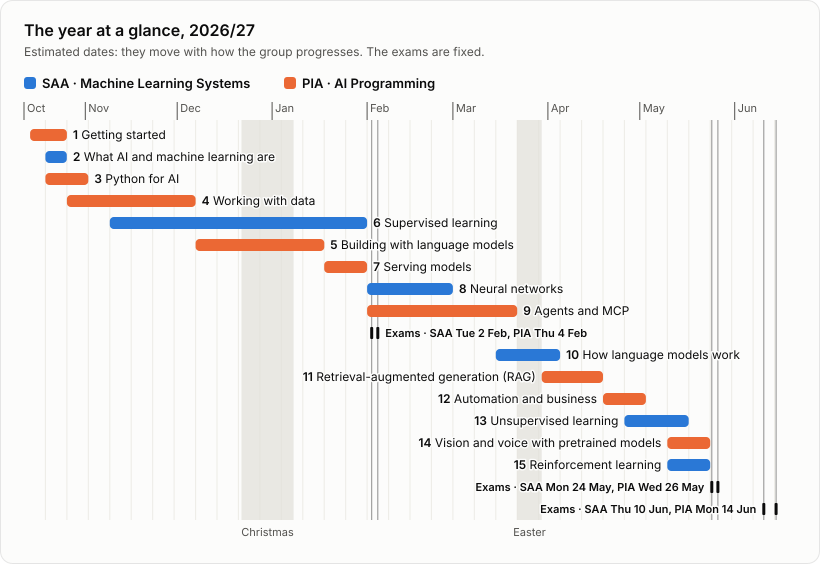

# Artificial Intelligence 2026/27

Materials for two modules of the specialisation course in Artificial Intelligence and Big Data, taught together as one path:

- **SAA · Machine Learning Systems**: how models learn from data, how they are trained, and how to tell whether they really work.
- **PIA · AI Programming**: building software with AI: Python and its tooling, language models, retrieval, agents, deployment and automation.

A [Spanish translation](https://github.com/NainIglesias/ai/tree/traduccion-es) is maintained by [NainIglesias](https://github.com/NainIglesias).

## Roadmap

The year in fifteen stages. The chart and the table's last column estimate when the group works on each one: follow those dates rather than the stage numbers, since stages of the two modules overlap. **The dates are estimates, not deadlines.** Only the exams are fixed: the other dates move with how the group progresses, each week's work is presented in the weekly session, and every change is made on this page. Materials are usually published well before they are needed, and you can always go ahead. If an exercise takes you longer, as numpy-mnist may if you are new to programming, finish it with your AI coding assistant, make sure you understand every line it writes, and move on with the group: the next stage doesn't wait.

Each stage belongs to one module: if you take only one, follow its rows, plus two of the other's. PIA's stage 6 needs SAA's note [Language models from the outside](saa/concepts/background/language_models.md), from stage 2, and PIA's stage 11 needs SAA's stage 10. Items marked *(coming)* are being written, and are linked when they are ready.
  
<table>
<thead>
<tr><th colspan="5" align="left">🟦 SAA · Machine Learning Systems &emsp; 🟧 PIA · AI Programming</th></tr>
<tr>
    <th align="right">#</th><th align="left">Stage</th><th align="left">Topic</th><th align="left">Worked examples</th><th align="left">Estimated dates</th>
</tr>
</thead>
<tbody>

<tr><th colspan="5"></th></tr>
<tr><th colspan="5" align="left">Term 1</th></tr>
<tr><th colspan="5"></th></tr>
<tr><td align="right">1</td><td>🟧 Getting started</td><td><a href="pia/setup/README.md">Setting up</a>: your tools, your fork of numpy-mnist, and your GitHub username in the aula virtual</td><td></td><td nowrap>14–25 Oct</td></tr>
<tr><td align="right">2</td><td>🟦 What AI and machine learning are</td><td><a href="saa/concepts/README.md">The map of the year</a>: each family of models, seen from the outside</td><td></td><td nowrap>19–25 Oct</td></tr>
<tr><td align="right">3</td><td>🟧 Python for AI</td><td><a href="pia/setup/why_python.md">Why Python rules AI</a>, although it is slow</td><td><a href="https://github.com/avidaldo/python-tic-tac-toe">Tic-tac-toe</a>, on program structure, recommended</td><td nowrap>19 Oct – 1 Nov</td></tr>
<tr><td align="right">4</td><td>🟧 Working with data</td><td><a href="pia/python-data-essentials/README.md">Python data essentials</a>: NumPy and pandas, the problems in a table, data from web APIs</td><td>The exercises of <a href="https://github.com/avidaldo/numpy-mnist">numpy-mnist</a></td><td nowrap>26 Oct – 6 Dec</td></tr>
<tr><td align="right">5</td><td>🟦 Supervised learning</td><td><a href="saa/supervised-learning/README.md">Supervised learning</a>: regression, classification, and how to tell whether a model really works; <a href="saa/data-preparation/README.md">Data preparation</a> after its part 3</td><td><a href="https://github.com/avidaldo/king-county">King County house sales</a>, <a href="https://github.com/avidaldo/california_e2e">California housing</a>, <a href="https://github.com/avidaldo/thyroid">thyroid disease</a></td><td nowrap>9 Nov – 31 Jan</td></tr>
<tr><td align="right">6</td><td>🟧 Building with language models</td><td>Local and remote models, prompts, structured output, testing a component that uses a model <em>(coming)</em></td><td><a href="https://github.com/avidaldo/ai-chat-guardrails">A chatbot with guardrails</a></td><td nowrap>7 Dec – 17 Jan</td></tr>
<tr><td></td><td colspan="3"><em>Christmas</em></td><td nowrap><em>22 Dec – 7 Jan</em></td></tr>
<tr><td align="right">7</td><td>🟧 Serving models</td><td>A model behind a web API and a demo, in a container, deployed <em>(coming)</em></td><td><a href="https://github.com/avidaldo/cifar-10-fastapi">An image classifier served with FastAPI</a>, and <a href="https://huggingface.co/spaces/avidaldo/cifar-10-fastapi-gradio">the same as a Gradio app</a></td><td nowrap>18–31 Jan</td></tr>
<tr><th colspan="5"></th></tr>
<tr><td></td><td><b>February exams</b></td><td>Term 1 (stages 1–7)</td><td></td><td nowrap>🟦 SAA <b>Tue 2 Feb</b> 🟧 PIA <b>Thu 4 Feb</b></td></tr>

<tr><th colspan="5"></th></tr>
<tr><th colspan="5" align="left">Term 2</th></tr>
<tr><th colspan="5"></th></tr>
<tr><td align="right">8</td><td>🟦 Neural networks</td><td>How a network learns, networks for tables, convolutional networks, reusing a pretrained network <em>(coming)</em></td><td></td><td nowrap>1–28 Feb</td></tr>
<tr><td align="right">9</td><td>🟧 Agents and MCP</td><td>Tool calling, agents that use tools safely, and MCP, a standard way to connect models to tools <em>(coming)</em></td><td></td><td nowrap>1 Feb – 21 Mar</td></tr>
<tr><td align="right">10</td><td>🟦 How language models work</td><td>From words as counts to embeddings, attention and transformers <em>(coming)</em></td><td></td><td nowrap>15 Mar – 4 Apr</td></tr>
<tr><td></td><td colspan="3"><em>Easter</em></td><td nowrap><em>22–29 Mar</em></td></tr>
<tr><td align="right">11</td><td>🟧 Retrieval-augmented generation (RAG)</td><td>A model's answers grounded in your own documents, citing their sources <em>(coming)</em></td><td></td><td nowrap>30 Mar – 18 Apr</td></tr>
<tr><td align="right">12</td><td>🟧 Automation and business</td><td>AI systems that run on their own, and whether they are worth it <em>(coming)</em></td><td></td><td nowrap>19 Apr – 2 May</td></tr>
<tr><td align="right">13</td><td>🟦 Unsupervised learning</td><td>Clustering, dimensionality reduction and anomaly detection <em>(coming)</em></td><td></td><td nowrap>26 Apr – 16 May</td></tr>
<tr><td align="right">14</td><td>🟧 Vision and voice with pretrained models</td><td><a href="https://github.com/avidaldo/computer-vision">Computer vision</a>: OpenCV, YOLO, CLIP embeddings and a face-authentication app. Voice: speech to text and text to speech <em>(coming)</em></td><td></td><td nowrap>10–23 May</td></tr>
<tr><td align="right">15</td><td>🟦 Reinforcement learning</td><td><a href="saa/reinforcement-learning/README.md">Learning from rewards</a>: agents, environments and Q-learning</td><td><a href="https://github.com/avidaldo/tictactoe-qlearning">Tic-tac-toe with Q-learning</a></td><td nowrap>10–23 May</td></tr>
<tr><th colspan="5"></th></tr>
<tr><td></td><td><b>May exams</b></td><td>The whole year (stages 1–15)</td><td></td><td nowrap>🟦 SAA <b>Mon 24 May</b> 🟧 PIA <b>Wed 26 May</b></td></tr>
<tr><th colspan="5"></th></tr>
<tr><td></td><td><b>June exams</b></td><td>The whole year (stages 1–15)</td><td></td><td nowrap>🟦 SAA <b>Thu 10 Jun</b> 🟧 PIA <b>Mon 14 Jun</b></td></tr>
</tbody>
</table>
  

<picture>
  <source media="(prefers-color-scheme: dark)" srcset="course/roadmap-dark.svg">
  
</picture>

## How to work

1. **Follow the [roadmap](#roadmap)** by its estimated dates, from stage 1, which sets up your tools. Each stage has a topic: open its README and work through its path in order. Run `git pull` to get each topic as it is published.
2. **Plan about 10 hours a week** for both modules, the weekly session included; they alternate in blocks. With less time, do the core items (★) first, and follow the projects, building them or reading, running and changing the teacher's solution; come back to the rest when you can. Unmarked items are the rest of the path, and the quiz asks about them too. Deep dives are optional and never assessed: each topic's README lists them after its path, with the item each one extends.
3. **Practise.** Reading and running is not enough: build the projects below, and try the practice tasks that some topics and worked examples suggest. Practice is never graded, and it is the best preparation for the exams.

## The projects

Public repositories that you fork and build on through the year, step by step. More may be added as the year goes.

| Project | Module | What you build | Starts |
| --- | --- | --- | --- |
| [numpy-mnist](https://github.com/avidaldo/numpy-mnist) | PIA | Images as NumPy arrays, with Git, tests and continuous integration. Keep your solutions: they come back later in the year | Fork it in stage 1, and solve its exercises in stage 4 |
| [Regulations assistant](https://github.com/avidaldo/fp-regulations-assistant) | PIA | An assistant that helps a teacher answer students' questions about vocational-training regulations, citing the articles in force | Stage 4 |
| [Property valuation](https://github.com/avidaldo/idealista18-avm) | SAA | An estimate of the price of a home from real listings, and of how far each estimate can be trusted | Stage 5 |

The two larger projects are built by the whole group, one step at a time:

- **Each step is an issue** in the project's repository, with the check that shows it is done. Ask your questions there.
- **Work in your fork**, and open a pull request that links the step's issue ([how](pia/setup/git_github.md#contributing-with-a-pull-request)). It is your submission: it receives feedback and is never graded, though once accepted it counts as a contribution.
- **The teacher's solution comes with the next issue**, with the good pull requests merged into it or instead of it. Bring it into your fork before you start the next step ([how](pia/setup/git_github.md#keeping-your-fork-up-to-date)).

The practical part of each exam works on these repositories.

## Exams and your grade

Each module is graded on its own, from in-person exams. February covers term 1: it is a compulsory rehearsal, and it can raise your grade, never lower it. May covers the whole year and gives your grade, and June is a second chance. Each exam has a quiz and a practical part on the projects. Accepted contributions can add up to 2 points to a module you have passed. Dates and rules: [How you are assessed](course/assessment.md).

## Improving the materials

If you find an error or something unclear, open an issue; if you can fix it, send a pull request. How, and how contributions count: [Improving the course materials](CONTRIBUTING.md).
